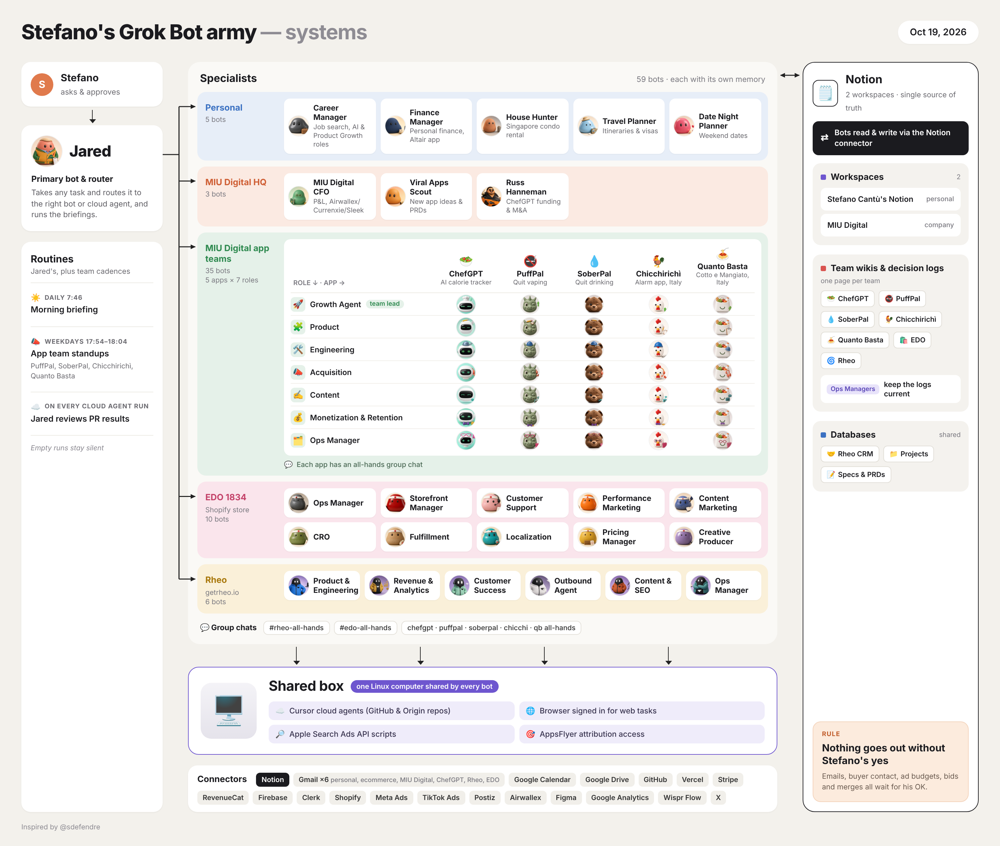

# AgentOS

A reusable template to rebuild a **multi-agent Grok bot army** like the reference architecture below: one **router** bot, specialist teams by business area, **Notion** as source of truth, a **shared Linux execution box** (Cursor cloud agents, browsers, API scripts), and a **human-in-the-loop** rule for anything external.



*Reference diagram (October 2026). Replace names, apps, and connectors in `templates/config.example.yaml` with your own.*

## What you get

| Path | Purpose |
|------|---------|
| [`templates/config.example.yaml`](./templates/config.example.yaml) | Your names, apps, stores, chats, Notion DBs, connectors |
| [`prompts/_foundation.md`](./prompts/_foundation.md) | Router bot instructions (run first) |
| [`prompts/company-admin-functions.md`](./prompts/company-admin-functions.md) | HQ: CFO, app scout, funding/M&A |
| [`prompts/private-life.md`](./prompts/private-life.md) | Personal specialists |
| [`prompts/mobile-app.md`](./prompts/mobile-app.md) | 7-role team **per** mobile app |
| [`prompts/ecommerce-business.md`](./prompts/ecommerce-business.md) | 10-role DTC / Shopify team |
| [`prompts/saas-business.md`](./prompts/saas-business.md) | 6-role SaaS team |
| [`prompts/GROKBOT_MASTER_SPINUP.md`](./prompts/GROKBOT_MASTER_SPINUP.md) | **Single prompt** with all categories |
| [`scripts/render-prompts.mjs`](./scripts/render-prompts.mjs) | Fills `{{placeholders}}` from config |

## Quick start

### 1. Configure

```bash
cp templates/config.example.yaml config.yaml
# Edit config.yaml — operator name, router bot, apps, ecommerce, SaaS, connectors
```

### 2. Render prompts (optional)

```bash
pnpm install
pnpm run render-prompts
# Open dist/prompts/GROKBOT_MASTER_SPINUP.md or individual category files
```

### 3. Create your router Grok bot

In Grok (or your Grok bot product), create one **primary** bot — your chief of staff / router (e.g. “Jared” in the reference diagram).

Paste **`prompts/_foundation.md`** (or rendered `dist/prompts/_foundation.md`). The router should propose a full roster and **wait for your approval** before spawning specialists.

### 4. Spin up specialists by category

Paste each category prompt into the **same router bot** (or follow your product’s “create sub-agent” flow), in this order:

1. [Company Admin Functions](./prompts/company-admin-functions.md)
2. [Private Life](./prompts/private-life.md)
3. [Mobile App](./prompts/mobile-app.md)
4. [Ecommerce business](./prompts/ecommerce-business.md)
5. [SaaS business](./prompts/saas-business.md)

**Or** paste everything at once: [`prompts/GROKBOT_MASTER_SPINUP.md`](./prompts/GROKBOT_MASTER_SPINUP.md).

### 5. Wire infrastructure

Match the diagram:

- **Notion** — team wiki per squad + shared CRM / Projects / Specs databases.
- **Shared box** — one environment for Cursor cloud agents, GitHub, and automation scripts.
- **Connectors** — enable only what you use (Gmail, Calendar, Shopify, Stripe, ads, etc.).
- **Group chats** — one all-hands channel per app, ecommerce brand, and SaaS product.

### 6. Hard rule (customize in config)

Default: **nothing goes out without your explicit yes** — email, buyer outreach, ad budget, bids, code merges.

## Architecture pattern (generic)

```text
You (ask & approve)
        │
        ▼
Router Grok bot ──routes──► Specialist bots (by category)
        │                           │
        │                           ├── read/write Notion
        └── briefings & PR review     └── shared Linux box + connectors
```

**Mobile apps:** `7 bots × N apps` (Growth, Product, Engineering, Acquisition, Content, Monetization & Retention, Ops).

**Ecommerce:** 10 roles (ops, storefront, support, performance marketing, content, CRO, fulfillment, localization, pricing, creative).

**SaaS:** 6 roles (product & engineering, revenue, CS, outbound, content/SEO, ops).

**Company admin:** CFO, viral apps scout, funding/M&A (rename to taste).

**Private life:** career, finance, housing, travel, date night (customize or remove).

## Customization tips

- Start with **router + one vertical** (e.g. one mobile app or SaaS), then add teams.
- Keep **personal bots** in a separate Grok project if your vendor supports isolation.
- Point `assets/agentos-architecture-reference.png` to your own diagram later — the prompts do not depend on the image.
- Scale down: delete sections from `GROKBOT_MASTER_SPINUP.md` you do not need.

## License

Use and adapt freely for your own AgentOS. The reference screenshot is an example deployment; replace all business names and PII with yours.
